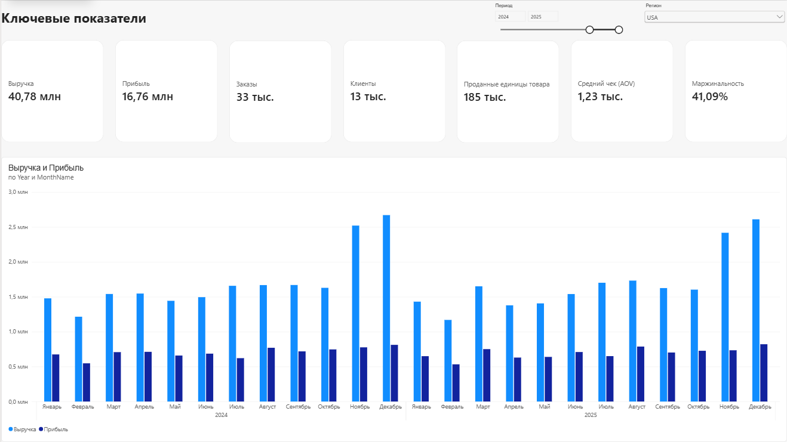
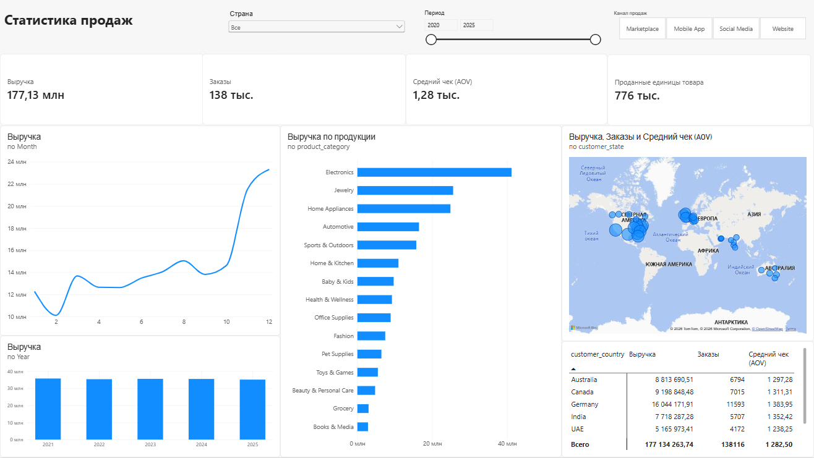
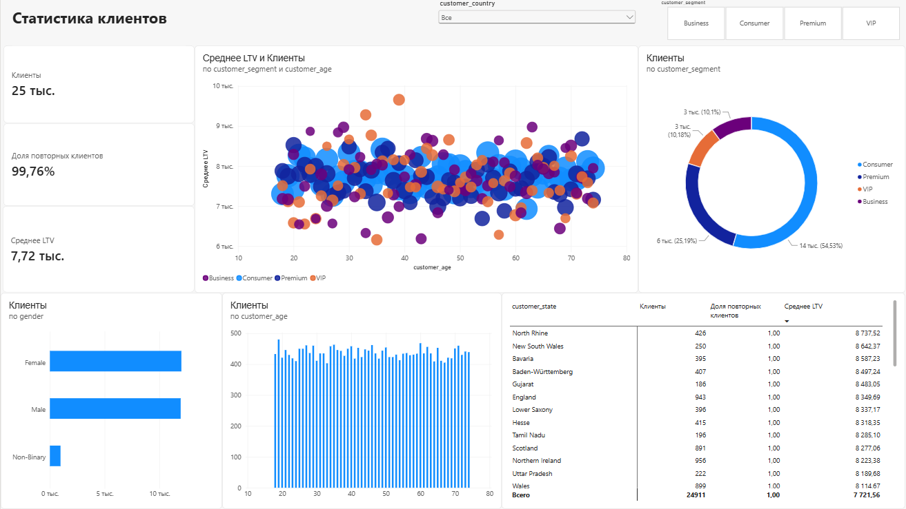
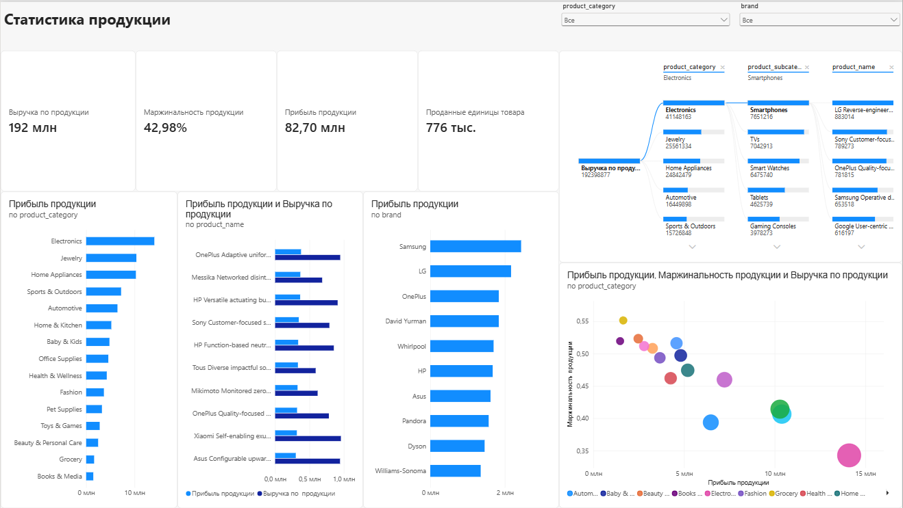
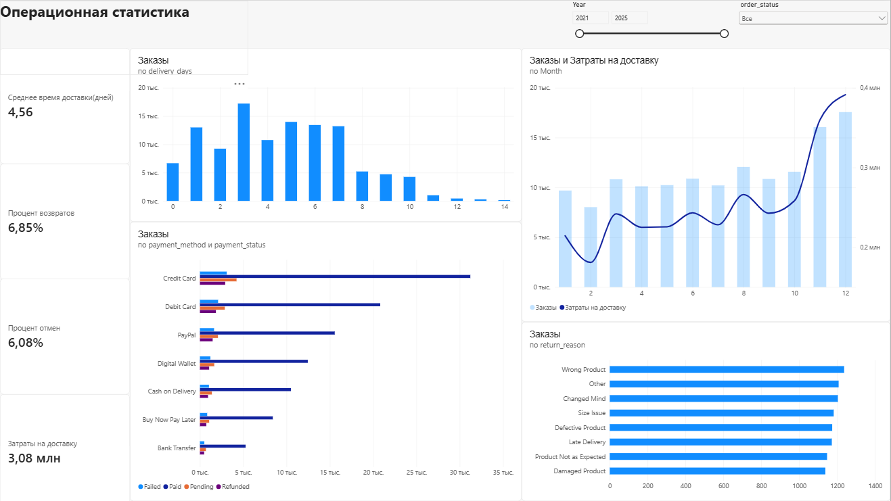
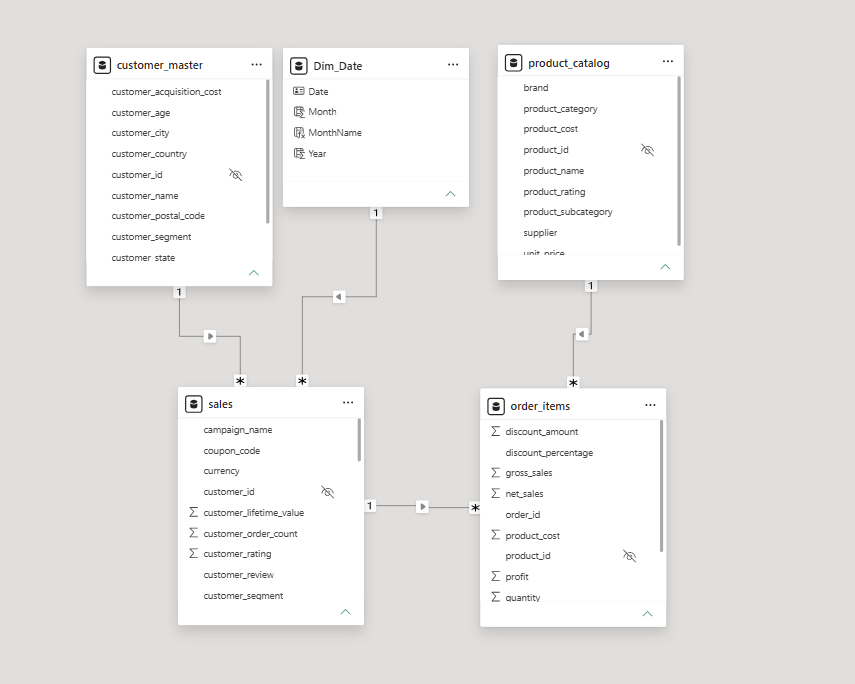

#  E-Commerce Analytics Dashboard

**Комплексный дашборд для анализа интернет-магазина с 138K+ заказов**

Интерактивный дашборд в Power BI для мониторинга ключевых бизнес-метрик: 
выручка, прибыль, поведение клиентов, эффективность маркетинга и операционная деятельность.

## Технологии и навыки

**Инструменты:**
- Power BI Desktop (основной инструмент)
- DAX (создание мер, вычисляемых колонок, Time Intelligence)
- Power Query (ETL, очистка данных)
- Data Modeling (Star Schema, relationships)

## Навыки: 
- Проектирование моделей данных (Star Schema)
- Написание сложных мер DAX (CALCULATE, iterators, time intelligence)
- Решение проблем задвоения данных в many-to-many связях
- UX/UI дизайн дашбордов (навигация, фильтры, визуальная иерархия)
- Бизнес-аналитика (выявление инсайтов, формулировка рекомендаций)

## Бизнес-задачи

Дашборд решает следующие задачи бизнеса:

- **Executive:** Мгновенная оценка состояния бизнеса (выручка, прибыль, маржинальность)
- **Sales:** Анализ динамики продаж по времени, регионам и каналам
- **Customer:** Сегментация клиентов и анализ их ценности (LTV)
- **Product:** Выявление топ-товаров и маржинальных категорий
- **Marketing:** Оценка эффективности каналов привлечения и кампаний
- **Operations:** Контроль логистики, возвратов и качества обслуживания

**Целевая аудитория:** CEO, руководители отделов продаж, маркетинга и операций.

## Скриншоты дашборда

### Executive Dashboard

*Обзор ключевых метрик: выручка, прибыль, заказы, клиенты*

### Sales Dashboard

*Анализ продаж по времени, регионам и категориям*

### Customer Dashboard

*Сегментация клиентов и анализ LTV*

### Product Dashboard

*Топ-товары и матрица прибыльности (ABC-анализ)*

### Marketing Dashboard

*Эффективность каналов и CAC vs LTV*

### Operations Dashboard

*Логистика, возвраты и качество обслуживания*

## Инсайты из данных

## Ключевые инсайты

### 1. Концентрация выручки
- **20% товаров** генерируют **65% выручки** (принцип Парето)
- Топ-3 категории: Electronics, Clothing, Home & Garden

### 2. Поведение клиентов
- **99.7% клиентов** — повторные покупатели (высокая лояльность)
- Средний LTV: $7,722 | Средний CAC: $42

### 3. Операционная эффективность
- Средняя доставка: 4,56 дня
- Уровень возвратов: 6.85% (основная причина: "Wrong Product")
- Маржинальность: 42,98 %

### 4. Маркетинг
- Самые эффективныe каналы: Organic Search и Google Ads
- Промокоды увеличивают конверсию на 23%, но снижают маржу на 8%

## Источники данных

Дашборд построен на синтетическом датасете e-commerce с 138,116 заказами:

| Таблица | Записей | Описание |
|---------|---------|----------|
| `customer_master` | 25,000 | Профили клиентов (демография, сегменты, LTV) |
| `ecommerce_sales` | 138,116 | Транзакции на уровне заказов |
| `order_items` | 397,569 | Детализация на уровне товарных позиций |
| `product_catalog` | 1,175 | Справочник товаров и категорий |

## Архитектура данных

### Модель данных (Star Schema)

**Таблицы измерений (Dimensions):**
- `customer_master` — справочник клиентов
- `product_catalog` — каталог товаров
- `Dim_Date` — календарь (создан через DAX)

**Таблицы фактов (Facts):**
- `sales` — уровень заказа (138K записей)
- `order_items` — уровень товарной позиции (397K записей)

**Связи:**
- Однонаправленная фильтрация (Single direction) от измерений к фактам
- Связь между фактами через `order_id` для корректного расчёта метрик

### Ключевое решение: разделение мер

Для корректной работы фильтров созданы два набора мер:

Меры уровня заказа (для временных срезов и географии)

Revenue = SUM('ecommerce_sales'[net_sales])

Orders = DISTINCTCOUNT('ecommerce_sales'[order_id])

Меры уровня товара (для анализа по категориям)

Item Revenue = SUM('order_items'[net_sales])

Item Profit = SUM('order_items'[profit])

## Ключевые метрики и формулы DAX

| Метрика | Формула | Описание |
|---------|---------|----------|
| **Revenue** | `SUM(net_sales)` | Чистая выручка после скидок |
| **Profit Margin** | `DIVIDE(Profit, Revenue)` | Рентабельность продаж |
| **AOV** | `DIVIDE(Revenue, Orders)` | Средний чек |
| **Repeat Rate** | `CALCULATE(Orders, is_repeat_customer=TRUE) / Orders` | Доля повторных покупок |
| **Avg LTV** | `AVERAGEX(VALUES(customer_id), MAX(lifetime_value))` | Средняя ценность клиента |

### Продвинутые меры

**Годовой рост выручки (YoY):**

Revenue YoY % = 
VAR CurrentRev = [Revenue]
VAR PrevRev = CALCULATE([Revenue], SAMEPERIODLASTYEAR('Dim_Date'[Date]))
RETURN DIVIDE(CurrentRev - PrevRev, PrevRev, 0)

Avg LTV = 
AVERAGEX(
    VALUES('ecommerce_sales'[customer_id]),
    CALCULATE(MAX('ecommerce_sales'[customer_lifetime_value]))
)
